<p align="center">
  
</p>

# Clawboard

**A crab colony that lives next to your Claude Code session.** Every crab is a real agent doing real work, so you can see what Claude is up to without reading the whole transcript.

Claude Code can spend minutes reading files, editing code, running tests and handing work to subagents. The transcript has all of it, but not at a glance. Clawboard is a side panel (a Claude Code mod) that keeps the important parts in view: who is doing what, what changed and why, how much context and quota is left, and how your project fits together.

<p align="center">
  
</p>

<sub>Artwork drawn by Clawboard's own crab renderer (`npm run assets`). These are renders of the colony scene, not screenshots of the whole panel. See [docs/CAPTURING.md](docs/CAPTURING.md) for how to capture real screenshots.</sub>

## What you get

| Workspace | What it shows |
| --- | --- |
| 🦀 **Crab Crew** | One crab for Claude, plus one for each real subagent. Each crab shows its task, what it is doing now, the files it changed and its latest result. Below the colony: a live timeline of changed files, commands, tests, errors and tasks, each with a plain-English summary. |
| 🌊 **The Tide** | Context-window use, five-hour and weekly plan limits with reset times, session cost, tokens per turn and per agent, and a usage history that survives restarts. Anything Claude Code did not report is marked unavailable. |
| 🗺️ **The Burrow** | A diagram of your project's architecture built from your real files and `import` statements, the detected tech stack with a one-line explanation of each technology, and a click-through view of each component's files and relationships. |
| 🐚 **Under the Shell** | Explanations of code changes and engineering decisions at beginner, intermediate or advanced level, plus short project-specific lessons with quizzes. |
| 🏠 **Crab House** | Rename, reorder and hide workspaces. Switch between compact and decorative layouts. Dress the crabs: color, shell, hat, skin, animation and name. Reduced-motion and idle-animation switches. |

The workspace names are the defaults; you can rename all of them.

## Install

Clawboard is a mod, installed from this repository as a marketplace.

In a Claude Code terminal session:

```
/plugin install clawboard --marketplace SJ-Hariharan/clawboard
```

From a shell:

```bash
claude plugin install clawboard --marketplace SJ-Hariharan/clawboard
```

In the Claude desktop app, where `/plugin` does not run: click **+** next to the prompt box, then **Plugins**, **Add marketplace** with `SJ-Hariharan/clawboard`, then **Add plugin**.

Then open the panel with `/clawboard`. On the desktop app it also opens by itself when a session starts; in the terminal it opens only when you ask, because there it draws inline in the transcript.

## Try it in two minutes

1. Open a project and run `/clawboard`. You get one crab, waiting.
2. Ask Claude something that touches files, for example *"add a short section about testing to the README"*. Watch the crab go from **exploring** (reading) to **coding** (editing) to **finished**.
3. Ask for something that uses subagents (*"use two subagents to review the tests and the docs"*). Each real subagent appears as its own crab while it runs.
4. Open **The Tide** to see context and limits, **The Burrow** and press **Scan project**, then click a component.
5. In **Under the Shell**, press **Generate a lesson from this code**.
6. In **Crab House**, give a crab a hat.

<p align="center">
  
</p>

## How the crabs know what Claude is doing

Nothing is simulated. Clawboard hooks the session's real events and reads the real tool calls.

| Claude is… | The crab is |
| --- | --- |
| reading, searching, listing files, looking something up on the web, running read-only commands such as `git status` | **Exploring** |
| editing or writing files, planning tasks, running other commands, calling other tools | **Coding** |
| hitting a failed tool call or failing tests, or ending a turn on an API error | **Debugging** |
| running a test command (`npm test`, `pytest`, `go test`, `cargo test`, `vitest`, `jest`, …) | **Testing** |
| waiting for you (a question, a plan to approve, a permission prompt) or idle | **Waiting** |
| done with its turn, or a subagent that has completed | **Finished** |

Subagents get their own crab from the moment Claude Code reports them. A session with no subagents has exactly one crab. The timeline, the crab list and the per-agent token counts last for the session and reset on `/clear`.

Select a crab with the name buttons under the colony (the panel's pictures cannot take clicks yet) to see its task, current activity, modified files and latest result.

## Usage data: where it comes from, and what it cannot tell you

| Shown | Source | Limits |
| --- | --- | --- |
| Context window | The same figures as the Claude Code status line: input tokens of the last response against the model's window. | Empty until the first response of a window (a fresh session, or right after compaction). |
| Context by category | Estimated locally, the way `/context` does, when you press **Break down by category**. | An estimate, not a bill. |
| Five-hour and weekly limits, reset times | The rate-limit readings that Claude Code received with its latest API response. | Only available when your account and host report them (typically a Claude subscription sign-in). Otherwise the panel says **Unavailable**. Clawboard never works out a limit from token counts. |
| Session cost | The session's cost ledger, as `/cost` totals it. | Absent where the host keeps no ledger. |
| Tokens per turn and per agent | The usage Claude Code reports when each turn finishes, summed over every API request in that turn. | Interrupted turns may report nothing. Input counts look large because every request re-sends the context. |
| Usage history | A reading saved when the figures change (at most once a minute) or every 15 minutes, kept across sessions. | Only as complete as the readings above; the last 600 are kept. |

## Customizing the colony

Open **Crab House**.

- **Workspaces:** rename them, move them up or down, hide the ones you do not use (Crab House itself always stays).
- **Display:** compact or decorative layout, colony layout (beach, row, grid), reduced motion (no animation at all), idle animations (blinking, speech bubbles, snoozing), automatic per-turn explanations (off by default; they use your model quota).
- **Wardrobe:** pick the main crab, a single helper, or every helper of one type, then set its name, color (12), shell (5), hat (9), skin (6) and animation (4). The preview crab can show every state.

Settings are saved across sessions. `/clawboard reset` restores the defaults.

## Explanations and lessons

Under the Shell asks the model, on demand, and only when you press a button (or turn on automatic explanations):

- **Explain this change** sends one diff to the model through your Claude Code session.
- **What changed and why** and **Engineering decisions** ask a question over this session's own transcript.
- **Generate a lesson** writes a lesson and a three-question quiz from the code changed in this session, or from your project's files if nothing has changed yet. Lessons are saved per project.
- **Explain how this is implemented** (in The Burrow) sends excerpts of a component's first few files.

These calls use your model quota and send code excerpts to the model, like any other prompt. Clawboard makes no network requests of its own and runs no external programs.

## The Burrow, in detail

The scan walks your project (skipping `node_modules`, `.git`, build output and similar; up to 5,000 files), reads `package.json`, `requirements.txt` / `pyproject.toml`, `go.mod`, `Cargo.toml`, `Gemfile`, Maven/Gradle files, `Package.swift`, `pubspec.yaml`, `Dockerfile`, Compose files, Prisma schemas, CI and hosting config, and recognizes the common frameworks and services in them. Components are grouped by layer (frontend, API, backend, database, integrations, tests, infra, config) from folder and file names, so the layers are a good guess rather than a guarantee. Arrows come from the `import` statements of up to 450 JavaScript, TypeScript, Vue, Svelte and Python files; other languages get a stack and file groups but no arrows yet.

## Supported environments

- **Claude Code:** written against 2.1.304; validated, tested and loaded on 2.1.311. The mod API is early access and can change between releases. If an update breaks Clawboard, please open an issue with the output of `claude --version`.
- **Desktop app:** the full experience, with drawn crabs, charts and diagrams.
- **Terminal:** the same data and controls, with text faces instead of drawn crabs and text bars instead of charts.
- **VS Code and mobile:** the panel is written to degrade on these surfaces, but they have not been tested.
- **Operating systems:** developed on macOS. Nothing in the mod is macOS-specific, but Linux and Windows have not been tried. (`scripts/render-png.swift` is macOS-only; it is only used to make the social preview image.)

What has and has not been checked is listed in the [release notes](docs/release-notes-0.1.0.md).

## Configuration and troubleshooting

Clawboard has no configuration file. Everything is in **Crab House**.

| Problem | Try |
| --- | --- |
| The panel is not showing | Run `/clawboard`. In the terminal it never opens by itself. |
| Limits say **Unavailable** | Claude Code has not received them. They need a supported sign-in and at least one response. This is expected on API-key setups. |
| Context shows nothing | It fills in after the first response of the session. |
| The Burrow is empty | The session is not in a project folder, or it has no recognizable files. Open a project and press **Rescan project**. |
| The Burrow is out of date | It says so when files have changed since the scan. Press **Rescan project** (or run `/clawboard scan`). |
| An explanation says the model did not answer | Try again. The message includes the reason the model call gave. |
| The mod does not load | Run `claude plugin validate <path to the mod>`, then start Claude Code with `claude --debug` and look for lines that start with `clawboard:`. |

## Development

```bash
git clone https://github.com/SJ-Hariharan/clawboard
cd clawboard
claude --plugin-dir .        # load the mod from this folder for one session
```

```bash
npm run validate             # claude plugin validate .
npm test                     # claude plugin test .   (engine-driven tests)
npm run assets:check         # README art is up to date with the renderer
npm run check                # all of the above
npm ci && npm run typecheck  # tsc against the engine's types (see below)
```

`npm run typecheck` needs the declarations Claude Code writes into `.claude-plugin/types/` when it loads a mod from a folder it watches (git-ignored). Run it after loading the mod once in an interactive session.

Where things are:

| Path | What it does |
| --- | --- |
| `hooks/register.tsx` | The hooks module: listens to session events and draws the pane. |
| `hooks/classify.ts` | Turns tool calls into crab states and plain-English summaries. |
| `hooks/views.tsx` | The five workspaces. |
| `hooks/crabs.ts` | The pixel-art crabs and colony scene (SVG). |
| `hooks/scan.ts` | The project scan behind The Burrow. |
| `hooks/actions.ts` | Model-backed explanations, lessons and quizzes. |
| `hooks/store.ts`, `hooks/io.ts` | Defaults and settings; the engine calls the helpers use. |
| `types/index.d.ts` | The mod's state contract. |
| `tests/` | Engine-driven UI tests and plain unit tests. |
| `scripts/` | Generators for the README art and social preview. |

See [CONTRIBUTING.md](CONTRIBUTING.md) before opening a pull request.

## Roadmap

- Real screenshots and a recorded demo ([docs/CAPTURING.md](docs/CAPTURING.md)).
- Click a crab in the scene to select it, instead of the buttons under it.
- Import graphs for Go, Rust, Java and Swift projects.
- Type-checking in CI, once the engine's types can be fetched without a session.
- Checks on Linux, Windows and VS Code.

## License

Released under the [MIT License](LICENSE).
